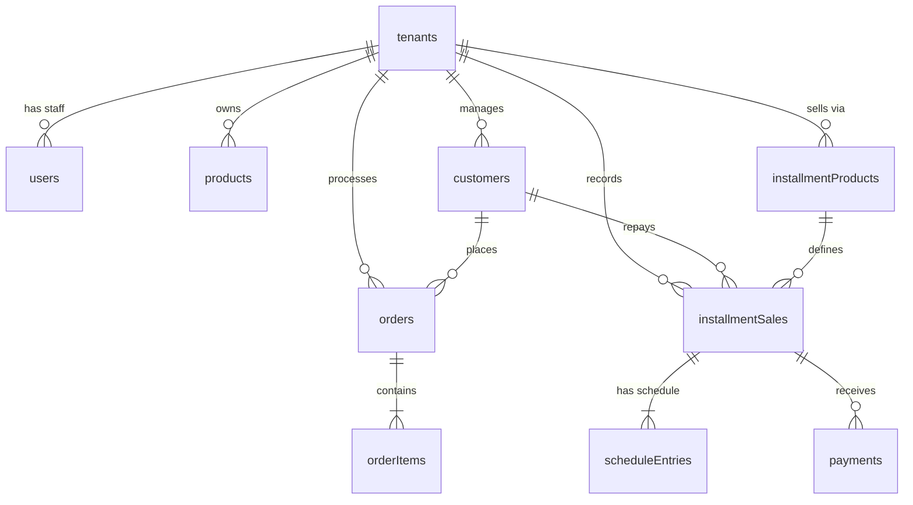
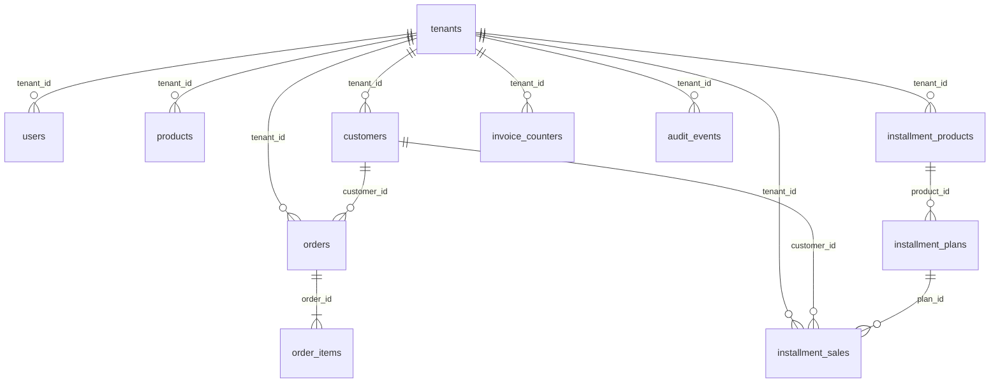

# KazmiOn — Database Design

## Overview

KazmiOn uses **MongoDB 7** as its primary operational database with a planned optional **PostgreSQL 16** layer for invoicing and analytics. This document covers both the current MongoDB schema and the target PostgreSQL schema.

---

## MongoDB Collections (Current Primary)

### Entity Relationship Overview



### Collection: `tenants`

The root entity — every piece of business data belongs to a tenant.

| Field | Type | Description |
|-------|------|-------------|
| `_id` | ObjectId | Primary key |
| `name` | String | Business name |
| `domainType` | Enum | retail, restaurant, pharmacy, etc. |
| `currency` | String | Currency code (PKR, USD…) |
| `invoicePrefix` | String | e.g. "INV" for INV-2026-0001 |
| `taxProfile` | Object | GST%, reduced%, charges[] |
| `featureFlags` | Object | pos, inventory, reports, customers, installments, barcodes |
| `status` | Enum | active \| suspended |
| `logoUrl` | String? | Business logo URL |
| `address` | String? | Business address |
| `taxRegNo` | String? | Tax registration number |
| `installmentMarkupPercent` | Number | Markup applied to installment prices |
| `invoicePrintSettings` | Object | Paper size, orientation, widthMm, heightMm |
| `subscriptionPlanId` | ObjectId? | Linked subscription plan |
| `navigationVisibility` | Object | Per-module nav visibility overrides |

### Collection: `users`

Staff accounts. Each user belongs to exactly one tenant.

| Field | Type | Description |
|-------|------|-------------|
| `_id` | ObjectId | Primary key |
| `tenantId` | ObjectId | FK → tenants |
| `name` | String | Full name |
| `email` | String | Unique login email |
| `passwordHash` | String | Argon2id (or bcrypt legacy) |
| `role` | Enum | owner \| admin \| cashier |
| `isActive` | Boolean | Account enabled |
| `moduleRights` | String[] | Module access overrides |
| `permissions` | String[] | Fine-grained action permissions |
| `branchIds` | ObjectId[] | Allowed branches |

**Indexes:**
```javascript
{ email: 1 }              // unique
{ tenantId: 1, role: 1 }
```

### Collection: `products`

Product catalog — inventory items available for sale.

| Field | Type | Description |
|-------|------|-------------|
| `_id` | ObjectId | Primary key |
| `tenantId` | ObjectId | FK → tenants |
| `name` | String | Product name |
| `sku` | String? | Stock keeping unit |
| `barcode` | String? | Barcode (EAN/UPC) |
| `category` | String? | Product category |
| `unit` | String? | Piece, kg, litre, etc. |
| `price` | Number | Selling price (NUMERIC equivalent) |
| `costPrice` | Number? | Purchase cost |
| `stockQty` | Number | Current stock count |
| `lowStockThreshold` | Number? | Alert threshold |
| `trackStock` | Boolean | Enable stock tracking |
| `taxClass` | Enum | standard \| reduced \| exempt |
| `attributes` | Object | Flexible key-value metadata |
| `isActive` | Boolean | Available for sale |

**Indexes:**
```javascript
{ tenantId: 1, sku: 1 }         // unique per tenant
{ tenantId: 1, barcode: 1 }
{ tenantId: 1, createdAt: -1 }
```

### Collection: `customers`

Customer profiles linked to orders and installment plans.

| Field | Type | Description |
|-------|------|-------------|
| `_id` | ObjectId | Primary key |
| `tenantId` | ObjectId | FK → tenants |
| `name` | String | Customer full name |
| `phone` | String | Primary contact number |
| `cnic` | String? | National ID (Pakistan) |
| `address` | String? | Home/office address |
| `guarantor` | Object? | {name, phone, cnic, address} |
| `notes` | String? | Internal notes |

**Indexes:**
```javascript
{ tenantId: 1, phone: 1 }
{ tenantId: 1, cnic: 1 }
```

### Collection: `orders`

POS sales transactions. The core financial record.

| Field | Type | Description |
|-------|------|-------------|
| `_id` | ObjectId | Primary key |
| `tenantId` | ObjectId | FK → tenants |
| `invoiceNo` | String | Formatted invoice number |
| `paymentMode` | Enum | cash \| card \| wallet \| installment \| mixed |
| `status` | Enum | completed \| voided \| refunded |
| `cashierId` | ObjectId | FK → users |
| `cashierName` | String | Denormalized for display |
| `customerId` | ObjectId? | FK → customers (optional) |
| `subtotal` | Number | Pre-discount total |
| `discountTotal` | Number | Total discounts applied |
| `taxableTotal` | Number | Taxable amount |
| `taxTotal` | Number | Total tax amount |
| `grandTotal` | Number | Final amount due |
| `idempotencyKey` | String | Duplicate prevention key |
| `items` | Array | Embedded `orderItems` |
| `invoiceStatus` | Enum | pending \| ready \| failed |
| `invoicePdfPath` | String? | Generated PDF path |

**Embedded: `orderItems`**

| Field | Type | Description |
|-------|------|-------------|
| `productId` | ObjectId | FK → products |
| `name` | String | Denormalized product name |
| `qty` | Number | Quantity sold |
| `unitPrice` | Number | Price at time of sale |
| `discountPercent` | Number | Line discount % |
| `taxPercent` | Number | Applied tax rate |
| `lineTotal` | Number | qty × (unitPrice − discount) + tax |

**Indexes:**
```javascript
{ tenantId: 1, createdAt: -1 }
{ tenantId: 1, invoiceNo: 1 }   // unique per tenant
{ idempotencyKey: 1 }            // unique
```

### Collection: `installmentSales`

Installment purchase agreements — the most complex financial entity.

| Field | Type | Description |
|-------|------|-------------|
| `_id` | ObjectId | Primary key |
| `tenantId` | ObjectId | FK → tenants |
| `agreementId` | String | Human-readable agreement ID |
| `customerId` | ObjectId | FK → customers |
| `installmentProductId` | ObjectId | FK → installmentProducts |
| `saleDate` | Date | Date of agreement |
| `actualPrice` | Number | Product cost price |
| `advancePayment` | Number | Down payment amount |
| `commissionRate` | Number | Markup/commission % |
| `commissionAmount` | Number | Calculated commission |
| `totalInstallmentPrice` | Number | Total to pay (cost + commission) |
| `installmentDuration` | Number | Number of installments |
| `paymentFrequency` | Enum | monthly \| weekly \| biweekly |
| `outstandingBalance` | Number | Remaining amount |
| `totalPaid` | Number | Cumulative paid |
| `saleStatus` | Enum | pending \| active \| completed \| overdue \| cancelled |
| `schedule` | Array | Generated payment schedule |
| `payments` | Array | Recorded payment history |

**schedule[] entries:**

| Field | Type |
|-------|------|
| `installmentId` | String |
| `dueDate` | Date |
| `expectedAmount` | Number |
| `amountPaid` | Number |
| `remainingAmount` | Number |
| `status` | String |

**payments[] entries:**

| Field | Type |
|-------|------|
| `paymentId` | String |
| `amount` | Number |
| `mode` | Enum |
| `paidAt` | Date |
| `receiptNo` | String |
| `note` | String? |

---

## PostgreSQL Schema (Target / Optional Hybrid)

> See migration file: [`database/postgresql/migrations/001_initial_schema.sql`](../database/postgresql/migrations/001_initial_schema.sql)

### Entity Relationship Diagram (PostgreSQL)



### Key Design Decisions

| Decision | Rationale |
|----------|-----------|
| `UUID` primary keys | Deterministic mapping from MongoDB ObjectIds |
| `mongo_id TEXT UNIQUE` on every table | Idempotent migration — `ON CONFLICT DO UPDATE` |
| `NUMERIC(12,2)` for all money | No floating-point rounding errors |
| `TIMESTAMPTZ` for all timestamps | UTC storage, timezone-aware queries |
| `JSONB` for schedule/payments arrays | Preserves MongoDB document structure |
| Compound index on `(tenant_id, created_at)` | Multi-tenant query performance |

### Financial Calculation Rules

> [!IMPORTANT]
> All financial calculations use `NUMERIC(12,2)` — never `FLOAT` or `DOUBLE PRECISION`.
> Database transactions wrap all financial writes.
> Idempotency keys prevent duplicate orders and payments.

```sql
-- Example: safe monetary sum
SELECT SUM(grand_total)::NUMERIC(12,2) FROM orders WHERE tenant_id = $1;

-- Example: transactional payment recording
BEGIN;
  UPDATE installment_sales SET amount_paid = amount_paid + $1 WHERE id = $2;
  INSERT INTO installment_payments (...) VALUES (...);
COMMIT;
```

---

## MongoDB → PostgreSQL Field Mapping

| MongoDB (camelCase) | PostgreSQL (snake_case) | Notes |
|--------------------|------------------------|-------|
| `_id` (ObjectId) | `id` (UUID) | Deterministic UUID from ObjectId |
| `tenantId` | `tenant_id` | UUID FK |
| `grandTotal` | `grand_total` | NUMERIC(12,2) |
| `createdAt` | `created_at` | TIMESTAMPTZ |
| `invoiceNo` | `invoice_no` | TEXT |
| `paymentMode` | `payment_method` | TEXT (enum-like) |
| `items` (array) | `order_items` table | Normalized |
| `schedule` (array) | `schedule` JSONB | Kept as JSONB |
| `payments` (array) | `payments` JSONB | Kept as JSONB |
